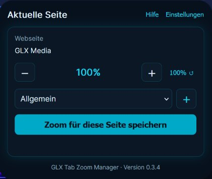
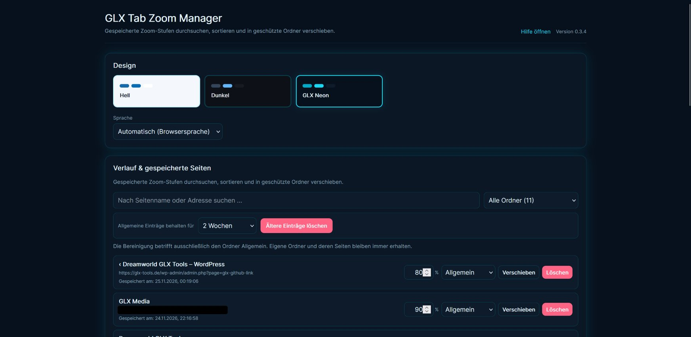
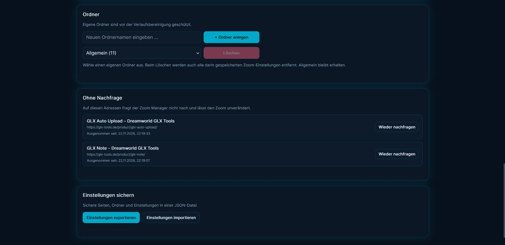

🌍 Sprachen: [🇺🇸 English](README.md) | [🇩🇪 Deutsch](README.de.md)

# 💠 GLX Tab Zoom Manager

### Dein Zoom, für jede Seite gemerkt.

*Speichert den Zoom für jede Webadresse und stellt ihn automatisch wieder her.* ⚡

   

---

## ⬇️ Download

👉 Neueste Version: [Releases](../../releases/latest)  
👉 Shop und Lizenzen: [glx-tools.de](https://glx-tools.de/product/glx-tab-zoom-manager/)

---

## 📖 Über GLX Tab Zoom Manager

### GLX Tab Zoom Manager – Individuelle Zoom-Stufen für jede Webseite

Der GLX Tab Zoom Manager merkt sich die perfekte Zoom-Stufe für deine besuchten Webseiten und wendet sie beim nächsten Aufruf vollautomatisch wieder an. Perfekt für hochauflösende Monitore, Barrierefreiheit oder komplexe Webanwendungen.

Das Besondere: Du bestimmst nicht nur den Zoom jeder Webseite, sondern kannst deine gespeicherten Seiten jetzt auch übersichtlich organisieren, in eigene Ordner sortieren und wichtige Einstellungen dauerhaft aufbewahren.

### Das Besondere: Intelligente Speicherung bis ins Detail

Im Gegensatz zu herkömmlichen Zoom-Erweiterungen merkt sich dieses Add-on die Zoom-Stufe pro vollständiger Webadresse (inklusive #-Anhängen).

Das ist ideal für moderne Webanwendungen wie ioBroker, Smart-Home-Dashboards oder Web-Apps, die unter derselben Domain verschiedene Ansichten über Raute-Parameter steuern (z. B. …/#tab-adapters und …/#tab-objects).

Jede Ansicht erhält genau den Zoom, den du möchtest – unabhängig von anderen Seiten derselben Domain.

### 1. Automatisches Speichern

Jede Änderung der Zoom-Stufe – egal ob über das Add-on-Popup oder klassisch per Tastatur und Maus (Strg + Mausrad) – wird erkannt und gespeichert. Datum und Uhrzeit der Speicherung werden ebenfalls festgehalten.

### 2. Live-Zoom-Popup mit direkter Ordnerverwaltung

Bei einer Zoomänderung erscheint ein eigenes Popup mit Informationen zur aktuellen Webseite und der eingestellten Zoom-Stufe (z. B. 70 %).

Direkt im Popup kannst du:

- Die gespeicherte Seite einem bestehenden Ordner zuweisen.
- Über die Plus-Schaltfläche einen neuen Ordner erstellen.
- Die Seite unmittelbar in den ausgewählten Ordner verschieben.
- Änderungen an bereits gespeicherten Zoom-Stufen übernehmen.

### 3. Komfortable Verlaufs- und Seitenverwaltung

Mit der erweiterten Einstellungsseite erhältst du eine vollständige Übersicht deiner gespeicherten Webseiten.

Auch bei 30, 40 oder mehr gespeicherten Seiten behältst du den Überblick.

- Suche nach Seitennamen oder vollständiger Webadresse.
- Anzeige aller gespeicherten Webseiten mit ihrem jeweiligen Zoomfaktor.
- Einzelne Webseiten gezielt löschen.
- Bereits gespeicherte Seiten nachträglich in andere Ordner verschieben.
- Zoom-Einstellungen direkt in der Übersicht bearbeiten.
- Anzeige des Speicherzeitpunkts jeder Webseite.

Du musst eine Webseite also nicht erneut aufrufen, um sie einem anderen Ordner zuzuordnen.

### 4. Eigene Ordner für wichtige Webseiten

Organisiere deine gespeicherten Zoom-Einstellungen ganz nach deinen Vorstellungen.

Neben dem fest integrierten Standardordner Allgemein kannst du beliebig eigene Ordner erstellen.

Beispielsweise:

- Smart Home
- ioBroker
- Nextcloud
- Verwaltung
- Häufig verwendete Webseiten
- Persönliche Favoriten

Über das Ordner-Dropdown kannst du gezielt einen Ordner auswählen und dir ausschließlich dessen gespeicherte Webseiten anzeigen lassen.

Jede Seite kann einzeln verschoben oder gelöscht werden.

Auch ganze Ordner lassen sich entfernen. Dabei werden sämtliche darin gespeicherten Webseiten und deren Zoom-Einstellungen ebenfalls gelöscht. Der Standardordner Allgemein bleibt immer erhalten.

### 5. Intelligente automatische Verlaufsbereinigung

Damit sich nicht über Monate unnötig viele Einträge ansammeln, bietet der GLX Tab Zoom Manager eine einstellbare Aufbewahrungsdauer.

Du kannst zwischen folgenden Zeiträumen wählen:

- 1 Woche
- 2 Wochen
- 3 Wochen
- 4 Wochen

Die Bereinigung berücksichtigt die gespeicherten Datums- und Zeitangaben.

Wichtig: Die automatische Bereinigung betrifft ausschließlich den allgemeinen Speicherbereich. Deine selbst angelegten Ordner sind geschützt und werden von der zeitgesteuerten Löschung nicht erfasst.

So kannst du häufig besuchte Webseiten automatisch verwalten lassen und gleichzeitig deine dauerhaft wichtigen Seiten behalten.

### 6. Datensicherung (Import/Export)

Sichere deine gesamten Zoom-Einstellungen einschließlich deiner Ordner und gespeicherten Webseiten mit der Export-Funktion in einer Datei.

Ideal für Backups, Neuinstallationen oder den Wechsel auf ein anderes Gerät.

Mit der Import-Funktion kannst du deine gesicherten Daten jederzeit wiederherstellen.

### 7. Modernes Design und individuelle Einstellungen

Das komplette Add-on bietet drei unterschiedliche Designs:

- Light Theme: Helles, übersichtliches Design.
- Dark Theme: Angenehmes dunkles Design.
- GLX Neon: Futuristisches Design im charakteristischen GLX-Neon-Look mit leuchtenden blauen und türkisen Akzenten.

Auch die Sprache lässt sich individuell einstellen:

- Deutsch
- Englisch
- Automatische Anpassung an die Browsersprache.

### 8. Integrierte Hilfe und Einstellungen

Eine ausführliche Hilfeseite erklärt die Funktionen und die Bedienung des Add-ons.

Über die Navigation gelangst du jederzeit direkt zwischen Einstellungen und Hilfe.

### Kurzanleitung: So einfach funktioniert es

- Auf das Symbol der Erweiterung in der Firefox-Symbolleiste klicken.
- Mit den Buttons + / − die gewünschte Zoom-Stufe einstellen – die Seite passt sich sofort an.
- Der GLX Tab Zoom Manager erkennt die Änderung und informiert dich über das Popup.
- Ordne die Webseite bei Bedarf direkt einem vorhandenen oder neu erstellten Ordner zu.
- Deine Zoom-Einstellung wird gespeichert und beim nächsten Besuch automatisch wieder angewendet.

### Für wen ist der GLX Tab Zoom Manager besonders geeignet?

Ob Entwickler, Administratoren, Smart-Home-Anwender oder ganz normale Internetnutzer: Wer regelmäßig mit vielen unterschiedlichen Webseiten arbeitet und für jede Ansicht eine individuelle Darstellung bevorzugt, wird die Möglichkeiten dieser Erweiterung zu schätzen wissen.

Besonders praktisch ist die getrennte Speicherung für komplexe Weboberflächen, bei denen unterschiedliche Unterseiten derselben Domain unterschiedliche Zoom-Stufen benötigen.

---

## 📸 Überblick & Screenshots

### 1️⃣ Zoom für die aktuelle Seite einstellen und speichern

### 2️⃣ Design, Sprache und gespeicherte Seiten

### 3️⃣ Ordner, Ausnahmen und Sicherung

---

## ✨ Funktionen

- 🚀 **Zoom pro Adresse:** Speichert eine eigene Zoomstufe für jede Webadresse, auch für Unterseiten.
- 🧩 **Automatisch wiederhergestellt:** Der gespeicherte Zoom wird sofort gesetzt, wenn du die Adresse wieder öffnest.
- ⚙️ **Schwebender Hinweis:** Änderst du den Zoom, erscheint auf der Seite ein Hinweis mit Speichern, Später oder Nie fragen.
- 🔒 **Immer lesbar:** Der Hinweis bleibt gleich groß, egal wie stark die Seite gezoomt ist.
- 📂 **Nie fragen:** Schließe eine Seite dauerhaft aus und zoome dort frei.
- ⚡ **Ausnahmeliste:** Alle ausgeschlossenen Adressen stehen in den Einstellungen. "Wieder fragen" hebt das auf.
- 🎨 **Fenster in der Leiste:** Zeigt den Stand der aktuellen Seite und schaltet sie bei Bedarf wieder ein.
- 🌍 **Auch auf besonderen Seiten:** Wo Add-ons nicht in die Seite dürfen, öffnet sich der Hinweis als kleines Fenster.
- 🛠️ **Zugriffsprüfung:** Fehlt der Zugriff auf eine Website, erscheint ein Knopf "Zugriff erlauben".
- 📊 **Drei Designs, zwei Sprachen:** Hell, Dunkel und GLX Neon, Deutsch und Englisch, eingebaute Hilfe.

---

## 🧩 Systemanforderungen

- Firefox

---

## 🧪 Testzeitraum & Lizenz

Kostenlos.

---

## 🔗 Mehr zu diesem Produkt

👉 [glx-tools.de](https://glx-tools.de/product/glx-tab-zoom-manager/)  
Support: **info@glx-tools.de**

---

## 📄 Lizenz

Copyright © 2026 GLX Tools – Gordon Lehmann. Alle Rechte vorbehalten.  
Dies ist proprietäre kommerzielle Software. Es wird keine Open-Source-Lizenz gewährt. Dieses Repository enthält nur Release-Downloads und Dokumentation; der Quelltext wird nicht veröffentlicht.

---

Mit ❤️ gemacht von **Dreamdancer100**

